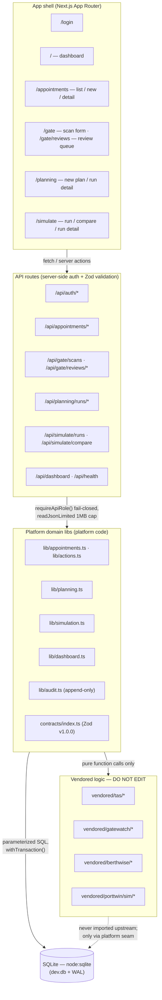

# Architecture — Port Operations Intelligence Platform (MVP)

**Status:** Demo MVP, branch `feat/mvp-slice-1`. All data synthetic. Not a production system.

## 1. System overview

A unified Next.js 15 (React 19) demo application that integrates business logic
from four standalone Casablanca port-operations repos into one platform:

| Module | Source repo (GitHub) | What it contributes |
|---|---|---|
| TAS | `eliem08/tas-casablanca` | Truck-appointment contracts (status state machine v1.0.0); optimizer vendored but not yet on an interactive path |
| GateWatch | `eliem08/gatewatch` | Gate-scan verification logic (`verify.ts`, `review.ts`) |
| BerthWise | `eliem08/berthwise` | Berth-allocation solvers (exact, greedy, annealing, tabu, genetic) |
| PortTwin | `eliem08/porttwin` | Discrete-event operations simulator (`runScenario`) |

Stack: Next.js 15 + React 19 (App Router), SQLite via `node:sqlite`, demo JWT
auth (HS256, httpOnly cookie), Zod contracts (unified v1.0.0 shapes),
Tailwind CSS. No external services, no message queues, no ORMs.

## 2. Layer diagram



Two enforcement points sit in front of everything:

- `src/middleware.ts` — every request except `/login`, `/api/auth/*`, `/api/health`
  requires a valid session cookie (API callers get 401 JSON; page visitors get
  redirected to `/login`).
- `requireApiRole(req, minRole)` — every API route and server action checks the
  session role server-side against a rank hierarchy. Client-side UI only *hides*
  buttons; the server decides.

## 3. Module boundaries: vendored vs platform code

**Vendored (`src/vendored/`) — read-only drops from the four source repos.**
Pure functions only: no I/O, no framework, no database access. Changes go
upstream first, get re-verified there, then get re-copied verbatim.

**Platform code — everything else.** Owns: HTTP surface, auth/session,
persistence, idempotency, audit trail, input validation, UI, demo data.

Concretely:

| Concern | Owner | Notes |
|---|---|---|
| Solver/verification/sim algorithms | Vendored | Never imported through a barrel except where upstream is acyclic (BerthWise contracts, PortTwin service) |
| Zod input contracts | Platform (`src/contracts/index.ts`) | v1.0.0 shapes; reuse TAS status enum and UTC-datetime discipline from the vendored TAS contract |
| Persistence | Platform (`src/lib/db/`) | SQLite; idempotency via UNIQUE constraints + transactions |
| Auth/session | Platform (`src/lib/auth.ts`, `src/middleware.ts`) | Demo JWT; roles |
| Audit trail | Platform (`src/lib/audit.ts`) | Append-only table; no UPDATE/DELETE queries exist |
| Seed/demo data | Platform (`src/lib/db/seed.ts`) | Synthetic, labeled `[SYNTHETIC DEMO DATA]` |

### What is actually used from each vendored drop (slice 1)

- **BerthWise** — `lib/berth.ts` (`planGreedy`, `planOptimized`, `planTabu`),
  `lib/ga.ts` (`planGA`), `lib/exact.ts` (`solveExact`), `lib/validate.ts`
  (`assertPlanningInputs`). `lib/alns.ts` is vendored but **deliberately never
  imported** — superlinear scaling, unsuitable for interactive use.
- **PortTwin** — `sim/service.ts` (`runScenario` — the single validated entry
  point), `sim/scenarios.ts` (preset definitions), `sim/contracts.ts`
  (`inputHash`, `loadSimulationInput`), `sim/errors.ts` (`toPublicError`).
- **GateWatch** — `lib/review.ts` (`routeScan`, `needsReview`,
  `DEFAULT_REVIEW_THRESHOLD`) in `POST /api/gate/scans`; `lib/verify.ts`
  (`verifyGateEventAgainstAppointment`) in the scan server action.
- **TAS** — contract reuse: `AppointmentStatus` enum and the UTC-Z datetime
  discipline (TAS contract v1.0.0). The TAS slot optimizer (`optimizer.ts`,
  `annealer.ts`, …) is vendored for provenance but not yet called by the
  platform.

## 4. Data flows for the three key scenarios

### 4.1 Appointment lifecycle (TAS)

```
/appointments/new (form) → server action createAppointmentAction
  → requireRole("operations_operator")
  → Zod: CreateAppointmentInput (strict)
  → INSERT with idempotency_key UNIQUE → duplicate retry returns same-ish error, no double row
  → audit("appointment.created") → redirect to /appointments/[id]
```

Status transitions follow the TAS six-status state machine, enforced in
`STATUS_TRANSITIONS` (platform contract) and re-validated in
`setAppointmentStatus`:

```
requested → confirmed → checked-in → completed
    ↓           ↓             ↓
cancelled   cancelled   cancelled / no-show
```

Transitions are invoked from `/appointments/[id]/transition-buttons.tsx` via
the `/api/appointments/[id]/status` route (role: `operations_operator`) or by
the gate-scan path (auto-accept → `checked-in`).

### 4.2 Gate verification (GateWatch)

```
gate/scan-form.tsx → submitScanAction (form) or POST /api/gate/scans (API)
  → requireRole("operations_operator")
  → Zod: SubmitScanInput { appointmentId, plateRead, containerRead, confidence }
  → LOAD appointment server-side by ID from SQLite
      (client-supplied appointment data is NEVER trusted — the replay-attack boundary)
  → vendored review.routeScan / verifyGateEventAgainstAppointment:
      - no reads at all            → scan-failed
      - NaN / out-of-range / < 70  → human-review   (fail-closed, regression-tested)
      - read ≠ appointment record  → human-review   (fail-closed)
      - status cannot → checked-in → human-review
      - all match                  → auto-accept (records check-in in same transaction)
  → INSERT gate_verification_events (simulated=1 ALWAYS)
     + optional review_items row (status pending) inside withTransaction()
  → audit("scan.submitted" / "scan.verified")
```

`/gate/reviews` lists pending items; a `supervisor` approves/rejects
(`decideReviewAction` / `/api/gate/reviews/[id]/decide`). Every record is
labeled `simulated: true` — the demo never claims a real scan happened.

### 4.3 Planning and simulation (BerthWise / PortTwin)

```
/planning (plan-form) → POST /api/planning/runs → requireRole("planner")
  → Zod: CreatePlanInput { scenarioName, vessels[≤20], berths[≤10], solver, seed, idempotencyKey }
  → map platform VesselInput/BerthInput → vendored Vessel/Berth
  → vendored solver: solveExact (≤8 vessels; throws above) | planGreedy |
    planOptimized | planTabu (2 s budget) | planGA
  → provenance label: exact → proven_optimal=1; heuristic → proven_optimal=0 + banner
  → INSERT berth_plans UNIQUE(input_hash, solver) → audit("planning.run_created")
  → /planning/runs/[id] renders assignments, utilization, unassigned vessels

/simulate (sim-form) → POST /api/simulate/runs → requireRole("planner")
  → Zod: CreateSimulationInput { scenarioName, scenarioId (vendored preset),
    seed, replications 10–500, paramOverrides allowlist, idempotencyKey }
  → vendored runScenario(rawInput): schema validate → deterministic Monte Carlo
    (baseSeed + replication scheme) → output contract validation → public error
  → INSERT simulation_runs (input_hash UNIQUE, calibrated=0 ALWAYS)
  → every surface carries UNCALIBRATED_NOTICE; KPI figures tagged provenance
    "simulated" or "assumed" — never "measured"
  → audit("simulation.run_created")
```

`/simulate/compare` pulls two runs by id (viewer role) for a side-by-side KPI
comparison. All run results are persisted in SQLite — no in-memory demo caches.

## 5. Vendoring policy

1. **Do not edit anything under `src/vendored/`.** Fixes, improvements, and
   behavior changes happen in the source repos first, are re-verified by their
   test suites there, then re-copied verbatim.
2. **Record the provenance.** Source SHAs for all four drops live in the root
   `VENDORED.md` (BerthWise, PortTwin sections) and in `docs/INTEGRATION-MATRIX.md`
   (all four). TAS and GateWatch SHAs were recovered by byte-comparison against
   the local source repos (clean working trees) because no VENDORED.md section
   was written at copy time — see INTEGRATION-MATRIX for details.
3. **Upstream fixes go upstream.** The platform keeps the minimum tested
   integration seam (e.g. the scan route around `routeScan`); it never forks
   vendored logic.
4. **Respect upstream constraints.** Import from specific vendored files, not
   through barrels, where upstream has circular imports (BerthWise solver
   modules — see `src/vendored/berthwise/VENDORED.md`). Never import ALNS into
   an interactive path.
